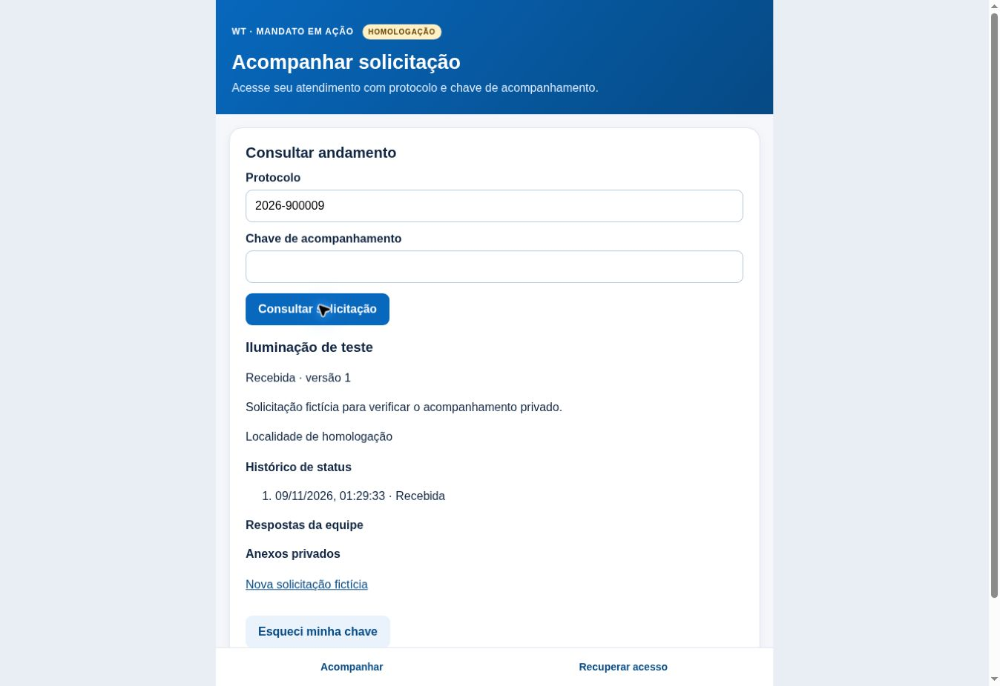

# Homologação: implementação, evidências e condições de liberação

Verificação em **09/11/2026, aproximadamente 01:38, America/Sao_Paulo**.
Somente `feature/recuperacao-whatsapp-manual`, Render
`mandato-neon-homologacao`, Neon `proud-firefly-64745516`, branch não primária
`br-lively-snow-bev5ecau`. Nenhuma execução ou alteração de produção/Play Store.

## 1. Melhorias implementadas

- Adaptação do contrato real consumido pelos clientes: ID de origem, protocolo,
  assunto, descrição, localidade, situação, datas, histórico de status, respostas,
  metadados de anexos e fiscalização. Fontes: `solicitacao.html`,
  `v2/solicitacao.html`, `painel/index.html` e inventário já versionado. Não houve
  leitura de cidadãos ou nova inspeção do banco de produção nesta rodada.
- Cadastro fictício pelos dois clientes, com os nomes de campos `p_nome`,
  `p_whatsapp`, `p_localidade`, `p_assunto`, `p_descricao` usados no cadastro atual.
  Chave aleatória de 32 bytes apresentada uma vez; somente HMAC fica no banco.
  O telefone é obrigatoriamente fictício nesse cadastro de homologação.
- Protocolo público separado do identificador interno da credencial. Cenários
  legados sem protocolo, numéricos e alternativos com separadores são cobertos.
  Nenhum protocolo ausente ou histórico de produção foi reescrito.
- Recuperação manual existente reutilizada para esses registros, com MFA recente,
  identidade e telefone conferidos, decisão justificada e código de seis dígitos
  válido por cinco minutos, consumo único e rotação atômica da chave.
- Consulta privada devolve histórico e respostas associados ao ID correto.
  Não devolve nome, telefone, anotações internas ou fiscalização ao cidadão.
  Anexos exibem nomes; URLs públicas e downloads não são liberados por esse fluxo.
- Painel ganhou catálogo administrativo autenticado e cenário legado fictício.
  Nome de conferência fica no retorno administrativo. Sem MFA recente, catálogo,
  decisão, emissão e auditoria continuam bloqueados.
- Cadastro passa a registrar o primeiro evento `Recebida`. Horários de histórico,
  validade e auditoria são apresentados no fuso `America/Sao_Paulo`, inclusive em
  navegador configurado em outro fuso. Isso não altera a duração do OTP.
- Preparado e ensaiado bloqueio das três RPCs antigas por protocolo, sem executar
  em produção. Remoção de EXECUTE de PUBLIC/anon/authenticated preserva o papel
  privado administrativo; o acesso HTTP desse papel exige a nova API com MFA.
- APK de depuração do Painel isolado: ID `.homologacao`, nome próprio, servidor
  HTTPS restrito à homologação, sem armazenamento DOM/banco/cache. Abertura
  externa nesse modo só admite WhatsApp com gesto do usuário. Release não foi
  compilada, assinada ou publicada.

O adaptador homologado conserva projeções do contrato real no schema privado
`auth_admin_hml`; **não é uma migração das tabelas reais nem sincronização com
produção**. A consulta em produção continua dependendo de implementação e aceite
específicos. Os aplicativos publicados não recebem estas telas automaticamente.

## 2. Arquivos e commits

| Commit | Alteração |
| --- | --- |
| `f6060e1` | Cadastro, adaptação do modelo, consulta completa privada, integração HTTP e cenários legados |
| `a737aed` | Histórico inicial, identificação administrativa, protocolos alternativos e roteiro do ensaio lógico |
| `9ed8778` | APK Android de homologação separado e verificação de identidade no CI; sem novo deploy Render |
| `35d0d19` | Horários do mandato nas telas e teste da virada do dia; versão final executável no Render |

Arquivos principais:

- `solicitacoes-modelo-hml.mjs`, `autoteste-modelo-hml.mjs`,
  `fluxo-isolado-hml.mjs`, `recuperacao-manual-hml.mjs`, `servidor-auth-hml.mjs`.
- `sql/solicitacoes-modelo-hml.sql`, `sql/auth-admin-hml.sql`,
  `sql/rascunhos/bloquear-rpcs-legadas.sql`, `sql/ensaio-restauracao-modelo-hml.sql`.
- `../../v2/solicitar-homologacao.html`, `../../v2/recuperar-acesso.html`,
  `../../v2/seguranca/{cliente-recuperacao-manual,tela-cadastro-hml,tela-recuperacao-manual}.mjs`.
- `../../painel/recuperacoes.html`, `../../painel/seguranca/recuperacoes.mjs`,
  cópias verificadas em `telas/`, manifesto, preparação e script de smoke.
- `solicitacoes-modelo-hml.test.mjs`, `bloqueio-rpcs-legadas-ensaio.test.mjs`,
  `tests-hml/http-auth.test.mjs`, `telas-definitivas-hml.test.mjs`.
- `../../android-painel/app/build.gradle`, `AndroidManifest.xml`,
  `MainActivity.java`, README Android e workflow `painel-v17-apk.yml`.

Este relatório e a imagem em `evidencias/` são documentação posterior aos commits
executáveis; publicação documental não precisa repetir testes ou reiniciar API.

## 3. Resultados verificáveis

Resultados do commit final **35d0d19**, obtidos dos logs do CI:

| Suíte | Testes declarados | Aprovados | Falhas | Ignorados |
| --- | ---: | ---: | ---: | ---: |
| API e segurança (`npm test`) | 454 | 452 | 0 | 2 |
| Autenticação/MFA/HTTP (`test:hml`) | 6 | 6 | 0 | 0 |
| Regressão V2/Painel | 29 | 29 | 0 | 0 |

Há sobreposição entre suítes e execuções locais/CI: **não somar como testes únicos**.
O aumento da suíte principal foi de sete casos úteis: adaptação/associação,
novos cadastros e isolamento de chaves, legados e preservação, restauração,
inicialização idempotente, contenção de RPC e fuso na virada do dia. Testes
aprovados foram repetidos localmente somente quando o código correspondente mudou.
O CI obrigatório executou as suítes configuradas em cada alteração funcional.

Os dois ignorados continuam sendo integrações externas legadas com fixture e
configuração próprias. Os marcadores Neon do fluxo novo não transformam esses
casos ignorados em aprovações.

Evidências CI:

- [API e segurança](https://github.com/wagnertomaszewski-boop/cartao-wagner-/actions/runs/42562287672)
- [Logs completos: API, MFA/HTTP e telas](https://github.com/wagnertomaszewski-boop/cartao-wagner-/actions/runs/42562287498)
- [HTTP no Render e prova Neon](https://github.com/wagnertomaszewski-boop/cartao-wagner-/actions/runs/42562287623)
- [Segurança de chaves](https://github.com/wagnertomaszewski-boop/cartao-wagner-/actions/runs/42562287602)
- [Compilação e identidade do APK de homologação](https://github.com/wagnertomaszewski-boop/cartao-wagner-/actions/runs/42562102713)

Artefato Android: `Painel-Homologacao-DEBUG-NAO-PUBLICAR`, ID `13650056408`.
Digest do artefato ZIP informado pelo GitHub:
`sha256:701512b76f198eef1fac81ca38dfc173514b717b9c6e7d7fa61b3b1415bcc44d`.
Não equivale a assinatura permanente de distribuição ou teste em aparelho.

## 4. Implantação e testes reais

Render: `35d0d19c756076446a8135f31d5b937e77a76327`, deploy
`dep-dbokp50473hc73antrtg`, **live** desde 09/11/2026 às 01:31:54 no fuso do mandato.
O smoke confirma as páginas dos três fluxos, módulos, no-store, origem externa
recusada, administração anônima recusada e marcadores reais Neon.

Os autotestes reais persistidos criaram exclusivamente cenários fictícios e
comprovaram cadastro Mandato/V2, chaves distintas, negativa cruzada, protocolo sem
chave recusado, recuperação de legado, primeiro status, protocolo com barra e
histórico preservado. Marcadores impedem a repetição em cada reinício. Não houve
novo envio externo de WhatsApp.

Pela interface do navegador:

- Cadastro fictício do Mandato e do V2 concluído, com chave inicial de 43 caracteres.
- Consulta correta mostrou assunto, descrição, localidade e status; o campo da
  chave foi limpo após envio. Protocolo sem chave é bloqueado no formulário.
- Chave errada produziu mensagem neutra e ocultou os dados anteriormente exibidos.
- Navegação para recuperação e envio de pedido fictício abriram a confirmação por
  código; o formulário exige seis dígitos e informa aprovação e expiração.
- Na versão corrigida, primeiro status e horário de Brasília foram conferidos.
- Painel sem MFA recusou catálogo sem mostrar dados. **A conferência visual do
  catálogo autenticado e dos novos botões administrativos permanece pendente**:
  a sessão não tem MFA recente e a solicitação de login seguro foi cancelada.
  O fluxo administrativo integrado foi testado por HTTP com login/TOTP reais no
  PostgreSQL isolado; isso não substitui a pendência visual descrita.

## 5. Integridade, auditoria e backup

Os oito registros anteriores de `auth_admin_hml.pedidos` mantiveram exatamente o
mesmo digest agregado antes/depois da implantação:
`13ac120e03191b46cece26747562776a`. Só novas fixtures representativas foram
acrescentadas. A migração SQL é aditiva; não exclui nem reescreve históricos.

Contagens acumuladas da auditoria, incluindo autotestes: MFA confirmado 10,
aprovação manual 10, rejeição 1, emissão 10, validação 7, reutilização bloqueada 3,
expiração recusada 1. Existe um marcador de cada novo autoteste integrado e de
formatos. Contagens não representam cidadãos, mensagens enviadas ou testes únicos.
Sem números pessoais, códigos ou chaves no relatório, no repositório ou na imagem.
Abertura do WhatsApp continua sendo intenção, nunca confirmação de entrega.

Backup gerenciado da homologação: a consulta retornou **zero snapshots** e agenda
vazia. Criar snapshot retornou `not allowed to snapshot non-root branch` (HTTP
400). Não foi tentado snapshot da branch primária nem alterado o plano.

Ensaio alternativo efetivamente executado:

1. Backup binário comprimido de PostgreSQL WASM com dados fictícios, restaurado em
   nova instância isolada; conferidos dados, chave, histórico e auditoria. Origem
   permaneceu intacta.
2. No Neon autorizado, checkpoint lógico de quatro modelos fictícios e dez eventos
   de auditoria, restaurado em **novas tabelas**, schema `ensaio_restauracao_hml`.
   Não contém senhas, sessões, TOTP, OTP ou telefones pessoais. As tabelas usam
   CREATE sem sobrescrita e não são servidas pela aplicação.
3. Backup/restauração de modelos: ambos quatro registros, digest
   `3a4b9a716730a6de89007e79dbf5ae83`. Auditoria: ambos dez registros, digest
   `484d78a3aedbc0ed065fc1aef65c730d`.
4. Papel `mandato_auth_hml` sem USAGE no schema de ensaio e sem SELECT no backup.

**Limite:** checkpoint no mesmo banco não protege contra perda do banco inteiro.
Não comprova backup independente, restauração de Storage, RTO/RPO de produção ou
restauração integral do provedor. Esses requisitos continuam bloqueantes para
produção. Existência de backup de produção não foi verificada nesta rodada.

## 6. Mudanças preparadas por plataforma e ordem de migração

| Plataforma | Mudança necessária, ainda não executada em produção |
| --- | --- |
| Supabase | Conferir schema/RLS/grants atuais; criar armazenamento privado de chaves/recuperações/auditoria; adaptar vínculo aos IDs reais; investigar protocolos nulos/alternativos; tratar URLs e bucket de respostas; revogar RPCs públicas após API/clients prontos |
| Render | Criar serviço próprio de produção com papel restrito, segredos novos, autenticação/MFA reais, origens, rate limit e monitoramento; manter homologação isolada |
| GitHub | Revisar migrações/adaptador reais, fixar candidato e artefatos, proteger segredos/ambientes e aprovar publicação; não mesclar esta branch automaticamente |
| Mandato/V2 | Integrar cadastro real à chave inicial, acompanhamento/histórico e recuperação; invalidar fallback público e tratar cache/service worker/versões antigas |
| Painel | Vincular catálogo/decisão ao cadastro real, autorização administrativa/MFA, auditoria e telefone autorizado; preservar operações legítimas existentes |
| Android/Play | Validar pacote próprio em dispositivo e só depois preparar release assinada/versionada; publicação exige autorização específica |

Ordem segura:

1. Inventário autorizado e recente, sem exportar cidadãos para a homologação.
   Fixar decisão de arquitetura; recomenda-se separar recuperação da eventual
   troca de banco. Não fazer dupla escrita sem reconciliação explícita.
2. Backup independente de banco e arquivos privados, restauração demonstrada,
   integridade e RPO/RTO medidos. Sem isso, não iniciar migração.
3. Adaptador de produção testado com cópia de schema e dados sintéticos; SQL
   versionado, idempotente e aditivo, com pré/pós-condições e papel mínimo.
4. API e clientes preparados sem tráfego público. Legados sem chave exigem
   identidade/contato conferidos, não chave derivada do protocolo ou emissão em massa.
5. Ensaio do bloqueio de RPCs, tabelas/Storage expostos e clientes antigos. O
   rascunho SQL tem trava de autorização e pré-condição de papel privado, mas
   ainda precisa de revisão no inventário definitivo. Não basta instalar a tela
   nova: chamadas diretas a RPCs e links antigos também precisam ser bloqueadas.
6. Apresentar commit, SQL, impacto, backup, janela, responsáveis e reversão ao
   usuário. Executar em produção somente após autorização expressa e específica.
7. Piloto autorizado: cadastro novo e legado, chave cruzada/ausente/errada,
   recuperação/MFA, rejeição, uso único, expiração, concorrência e anexos privados.
   Expandir somente sem falhas de segurança ou integridade.
8. Em falha, interromper expansão e recurso afetado, preservar auditoria e escritas
   válidas. **Nunca reabrir consulta por protocolo nem reativar chaves revogadas**.
   Não restaurar backup sobre solicitações posteriores; reconciliar primeiro.
   Preferir correção posterior e schema aditivo inativo a exclusão urgente.

O procedimento `PROCEDIMENTO-MIGRACAO-REVERSAO-PRODUCAO.md` continua complementar.
Nada neste relatório é uma autorização para executar essas etapas em produção.

## 7. Pendências reais para concluir o aceite e liberar aos cidadãos

- Renovar login/MFA para conferência visual do catálogo administrativo e dos novos
  botões; a solicitação segura foi cancelada, sem nova tentativa nesta rodada.
- Instalar/testar o APK isolado em Android autorizado, incluindo WhatsApp/Business,
  teclado, Voltar e MFA. V2/Mandato publicados e versão release não foram testados
  com esta integração; não há APK/AAB de distribuição desses clientes nesta branch.
- Garantir backup independente/restauração integral de banco **e Storage**; o
  bloqueio de snapshot da branch secundária permanece.
- Finalizar adaptador/API/SQL de produção e novo cadastro real; o ensaio atual é
  um modelo isolado compatível com os contratos, não a migração de cidadãos.
- Executar inventário e contenção final das RPCs/acessos/URLs de produção somente
  em fase autorizada. As proteções homologadas não estão ativadas nos publicados.
- Autorizar implantação, piloto e distribuição após cumprimento dos requisitos.
- Dois testes legados externos seguem ignorados e identificados nos logs.

Falhas encontradas e corrigidas nesta rodada: falta da estrutura completa no
acompanhamento homologado, histórico inicial ausente, nome administrativo não
preservado, formatos alternativos limitados, exibição de fuso incorreta e APK debug
apontando para produção. Uma edição intermediária duplicou variável no teste HTTP;
foi corrigida e o teste voltou a passar. **Zero falhas atuais nas suítes finais.**

Conclusão técnica: o fluxo homologado avançou e está implantado com evidências;
a migração e a liberação aos cidadãos continuam bloqueadas pelas pendências
explícitas, sem declaração de conclusão integral dos três aplicativos.
